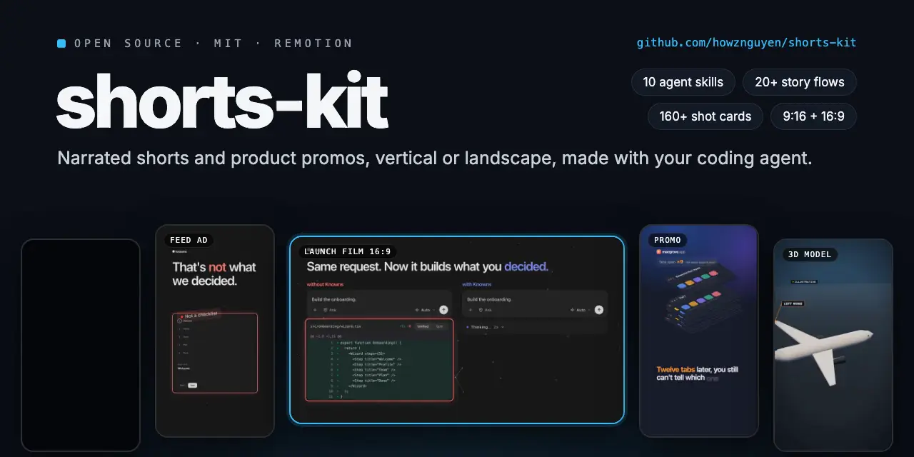
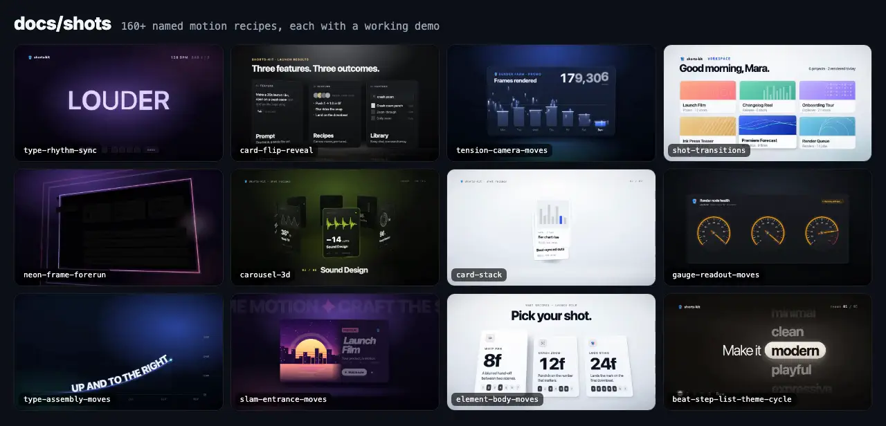
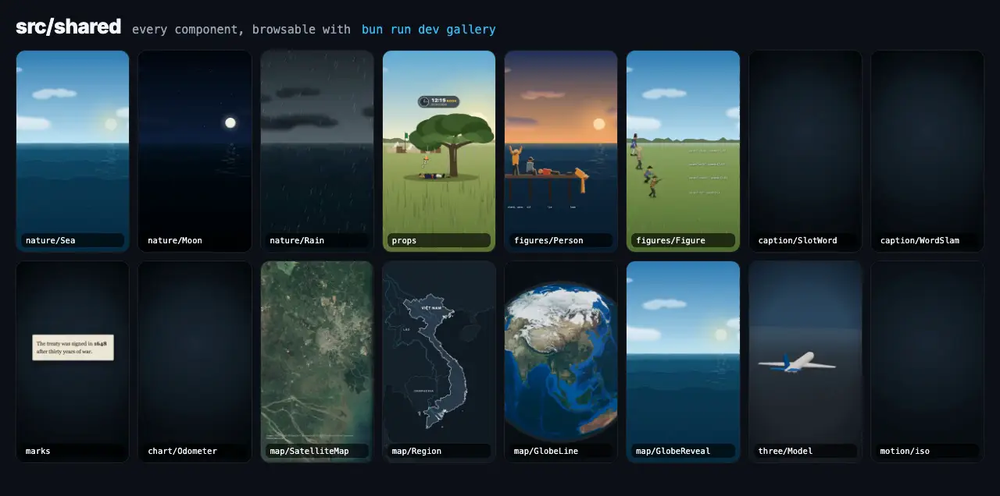

<p align="center">
  
</p>

# shorts-kit

[](https://discord.knowns.dev)
[](https://www.facebook.com/groups/agentic.coding.vietnam)
[](LICENSE)



Make narrated vertical shorts (TikTok, YouTube Shorts, Reels), and product promos in 9:16 or 16:9, with a coding
agent and [Remotion](https://www.remotion.dev).

You talk to your agent ("make a video about why the sky is blue"). The agent follows
the kit's skills step by step: facts first, a storytelling flow, the script, the voice,
the scenes, stills to check, the render, the cover and the caption. You review, then you
upload the file yourself. The kit never posts anything.

The rules and skills come from a private pipeline that took a new knowledge channel from
zero to about 120k views on its best video in two months. Every rule keeps the reason it
exists, because most of them were written after a published video broke it. They are
defaults: change them for your own channel.

## Results

The channel these rules came from, two months in. The best videos and the flops sit side
by side on purpose: topics close to the audience carried it (tens of thousands of views),
topics that drifted from the channel's niche got a few hundred. The kit cannot pick your
topic for you.


What a finished run reports, from the original private pipeline (it also copied files to
a NAS and applied that channel's own swearing rule; neither is part of this kit):


## What is in the box

- **10 agent skills** (`.claude/skills/sk-*`), started by `sk-pipeline` (shorts) or `sk-promo` (ads and launch films). They work in
  Claude Code, and in any agent that reads `AGENTS.md` (Codex, OpenCode, ...).
- **SOUL.md**: your channel's rulebook. Voice, sentence style, writing for a
  text-to-speech voice, safe zones, captions, audio, facts, covers, hand-off. Each rule
  is tagged `[measured]`, `[default]`, `[craft]` or `[hard]` so you know how freely to
  change it.
- **20 storytelling flows** (`docs/flows/`): Three reasons, Trace back, Explain it,
  Reading a graph, Empty world with a late reveal, and more. Each has beats, when to use
  it and its traps.
- **A fact ledger** (`docs/facts/`). No sentence goes into a script before its claim
  has a verified record, and the linter enforces it.
- **A Remotion library** (`src/shared/`): word-timed captions, kinetic type, safe-zone
  overlay, music bed and SFX, camera moves, and an illustrated world (sky, sea, sun,
  moon, stars, clouds, rain, birds, people, fish).
- **Maps and a globe** (`src/shared/map/`): satellite imagery with a camera that flies
  from country to street and stays sharp, coastlines, borders and rivers from Natural
  Earth, routes that draw on, pins, measured distances, filled regions, a ready Vietnam map
  with the Hoàng Sa and Trường Sa archipelagos, a 3D globe with great-circle lines, and a
  pull-out from any scene to the globe.
- **Shared graphics** for any video: strike-and-replace, slot word, word slam, typewriter,
  hand-drawn circles, arrows, underlines, cross-outs and stamps, and charts that stay true to
  scale (compare bars, progress ring, unit grid, odometer). Browse them with `bun run dev gallery`.
- **Your own voice or footage instead of TTS** (`bun run ingest`, `bun run cut`): Whisper
  transcribes the recording, fillers, retakes and long silences are proposed as cuts, and
  the cut voice drives the video like a TTS voice would. Film yourself (`talking-head`, the
  take is the background and effects stay off your face) or bring a voice recording only.
  The words stay what was said: every claim in them still needs a verified fact. See
  [docs/visuals/talking-head.md](docs/visuals/talking-head.md).
- **Product promos** (`sk-promo`, `docs/promo/`): the gates an agency would run, in order: objective and
  placement, the user's pain first, concept routes, a confirmed treatment, a timed animatic with the real music
  on a measured beat grid (`bun run beats`) and a scratch voice (`bun run voice`), a shot-by-shot storyboard,
  then the build, cutdowns (15 s, 6 s) and a stranger comprehension test. Vertical feed ads and 16:9 launch films.
- **A shot library** (`docs/shots/`): 160+ named motion recipes (camera, typography, UI entrances, rhythm,
  transitions, effects, outros, isometric piles, real typed search), each with parameters in frames, and sound
  cards for the SFX pack. Storyboard shots name their card.

  
- **Real interface components** in films (`docs/promo/real-ui.md`): Knowns UI by default, or a product's own
  components copied from its repo, driven frame by frame, deterministic (a render twice gives the same file);
  `bun run capture` for real pages (`--type` to type into the page's own search, `--hide` for overlays).
- **3D**: a Three.js scene kit (`src/shared/three/`: shots, camera rigs, callouts glued to a model) and procedural
  models built headless with Blender (`bun run model`), plus CSS-3D isometric piles and turns
  (`src/shared/motion/iso.tsx`).
- **8 CC0 sound effects** generated by the kit (`public/sfx/`), and a guide to using
  them ([docs/shots/sfx/](docs/shots/sfx/README.md)).
- **Scripts** for every step, from TTS with word timestamps to a platform-ready encode.
- **A local dashboard** (`bun run preview`) showing each video's progress, the render,
  the stills, the cover at profile-grid size, and the caption ready to copy. The Script tab
  plays the voice with the spoken word highlighted; the Storyboard tab shows every planned
  shot with its line, still and playback, for approval before scenes are built. The steps
  it tracks come from `docs/pipeline.json`, so a step your channel adds shows up too.




## Requirements

- [Bun](https://bun.sh) 1.3 or later
- [ffmpeg](https://ffmpeg.org) and ffprobe on your `PATH`
- A coding agent: [Claude Code](https://claude.com/claude-code), Codex, OpenCode, ...
- A voice. The default depends on the video's language; pick another any time:
  - **English → `edge`** (Microsoft Edge online voices): free, no key. The service
    sometimes stops answering; `bun run tts` retries.
  - **Vietnamese → `vieneu`** ([VieNeu-TTS](https://github.com/pnnbao97/VieNeu-TTS)):
    free and offline on CPU, 25 preset voices or clone your own. Needs Python 3.10+.
  - [ElevenLabs](https://elevenlabs.io): best quality in either language, needs an API key.
  - `say` (built into macOS): free and offline, for testing only. The example uses it
    so the kit runs with no network.
  - **Your own recording** (optional): needs [whisper.cpp](https://github.com/ggml-org/whisper.cpp)
    (`whisper-cli`) and its `large-v3-turbo` model, below.

Install the tools:

```bash
# macOS
brew install bun ffmpeg

# Linux
curl -fsSL https://bun.sh/install | bash
sudo apt install ffmpeg

# Windows (PowerShell)
powershell -c "irm bun.sh/install.ps1 | iex"
winget install ffmpeg
```

## Install

```bash
git clone https://github.com/howznguyen/shorts-kit.git
cd shorts-kit
bun install
```

For ElevenLabs, copy `.env.example` to `.env` and set `ELEVENLABS_API_KEY`.

For VieNeu (Vietnamese), install it once into a local Python env (needs [uv](https://docs.astral.sh/uv/)):

```bash
uv venv --python 3.12 .venv-vieneu
uv pip install --python .venv-vieneu/bin/python vieneu
.venv-vieneu/bin/python scripts/lib/engines/vieneu_bridge.py --voices   # downloads the model (~600 MB), lists voices
```

Then in `narration.json`: `"voice": {"engine": "vieneu", "voice": "Thiện Minh"}`. `voice`
is a preset name or the path to a 3–8 s `.wav` to clone (only a voice you have the
right to use).

To use your own recording instead of TTS, install whisper.cpp and download the model once (1.6 GB):

```bash
brew install whisper-cpp     # macOS; on Linux or Windows build it from github.com/ggml-org/whisper.cpp
mkdir -p .cache/whisper && curl -L -o .cache/whisper/ggml-large-v3-turbo.bin \
  https://huggingface.co/ggerganov/whisper.cpp/resolve/main/ggml-large-v3-turbo.bin
```

## Check that it works

Build the example video ("Why is the sky blue?", about 43 s) from start to finish. On
macOS this needs no key and no network except for fonts:

```bash
bun run tts example        # voice + word timestamps
bun run lint example       # machine checks: 0 errors expected
bun run render example     # out/example/example.mp4
bun run cover example      # out/example/example-cover.png
bun run normalize example  # loudness to -13 LUFS
bun run encode example     # out/example/example-upload.mp4, ready to upload
bun run preview            # open http://127.0.0.1:7788
```

On Linux or Windows there is no `say`: set `"engine": "edge"` (or `"elevenlabs"`) in
`src/videos/example/narration.json` first.

## Make your own channel

Open your agent in the repo and say:

> set up the kit for my channel

`sk-improve` asks about your niche, language, platform, voice, tone and video length,
then edits `SOUL.md` and `docs/soul/thresholds.json` to match, and logs every change.

Then:

> make a video about <your topic>

`sk-pipeline` takes it from there. It tells you where it is and what it needs from you:
mostly approving the script, listening to the voice, and looking at stills.

Already have a recording? Say:

> make a video from ~/Movies/take.mov

The agent runs `bun run from` (a `talking-head` video, or a voice-only one for an audio file;
several clips or a folder work too), and asks you what you actually said wherever Whisper was unsure. Expect
that: on a real take it misheard a phrase as a number and dropped whole words.

## Commands

| Command | What it does |
| --- | --- |
| `bun run new <id> --flow <A..T>` | scaffold `src/videos/<id>/` from a flow's beats |
| `bun run dev <id>` | Remotion Studio for that video |
| `bun run tts <id> [--force]` | synthesise the whole script, write the audio and `voice.json` |
| `bun run from <file\|dir>...` | "here is my video, edit it": scaffold, transcribe every clip, cut, storyboard stub, and the questions only the speaker can answer |
| `bun run ingest <id> <file>` | recorded voice instead of TTS (a filmed take or a voice recording): Whisper transcript and proposed cuts |
| `bun run cut <id>` | apply the reviewed `cuts.json`: the voice track (and the cut video for `talking-head`), `voice.json` |
| `bun run storyboard <id> [--init\|--sync]` | the shot list after the voice: scaffold it, print each shot with its time and what to fix; `--sync` re-pins shots to their lines after the words change |
| `bun run lint <id>` | style, facts, length and timing checks from `thresholds.json` |
| `bun run facts` | validate the fact ledger |
| `bun run still <id> --frame=N [--safe]` | one frame to `out/<id>/`, with the safe-zone overlay if `--safe` |
| `bun run render <id>` | `out/<id>/<id>.mp4` |
| `bun run cover <id>` | `out/<id>/<id>-cover.png` and `.jpg` |
| `bun run normalize <id>` | loudness to target, `out/<id>/<id>-loud.mp4` |
| `bun run encode <id>` | yuv420p, BT.709, 48 kHz, faststart: `out/<id>/<id>-upload.mp4` |
| `bun run preview [--lan]` | local dashboard; `--lan` adds a token so a phone on your Wi-Fi can open it |
| `bun run satellite <id>` | satellite mosaics for the shots in `src/videos/<id>/map.json` (EOX, CC BY 4.0) |
| `bun run geo <id>` | coastlines, borders and rivers for the same area (Natural Earth) |
| `bun run beats <file>` | measure a music track's beat grid for a promo (bpm, first beat) |
| `bun run voice <id>` | a promo's few spoken lines, one request each, with word times |
| `bun run capture <id> <url> --name <n>` | real pixels of a real page (`--mobile`, `--full`, `--select`, `--type`, `--hide`) |
| `bun run css <id> [--dir <folder>]` | build the Tailwind stylesheet for real components copied into a video |
| `bun run model <name>` | a procedural 3D model with Blender, headless, to `public/models/gen/` |
| `bun run check` | import boundaries and type check |
| `bun run dev gallery` | browse every shared component |

## Layout

```
SOUL.md                 your channel's rules (start here)
AGENTS.md, CLAUDE.md    agent entrypoint: invoke sk-pipeline first
.claude/skills/         sk-pipeline, sk-promo, sk-brief, sk-facts, sk-narration,
                        sk-style, sk-scene, sk-render, sk-handoff, sk-improve
docs/soul/              one file per rule section, plus thresholds.json
docs/flows/             20 storytelling flows
docs/visuals/           visual types
docs/promo/             promo rules, aesthetics, sound, real UI components
docs/shots/             the shot library (motion and sound cards)
docs/facts/             the fact ledger
docs/lessons/           why videos get zero views; how to measure your niche's style
briefs/                 one brief per video
src/shared/             the Remotion library, grouped by kind
src/videos/<id>/        one video: its own entry, narration.json, voice.json (or promo.json)
src/demo/               reference code the shot cards link to (not built)
scripts/                every command above
public/sfx/             CC0 sound effects
out/<id>/               hand-off files (not committed)
```

Each video has its own Remotion entry, so a broken video never breaks another one, and
`bun run check` stops a video from importing another video.

## What you still do yourself

- Pick the topic. Topic choice moves views more than anything in this kit.
- Approve the script, listen to the voice once end to end, and approve the storyboard.
- Look at the stills and the render. The agent catches layout bugs, not dull videos.
- Upload, set the cover, and paste the pinned comment (it carries the credits).
- After posting, give your agent the numbers so `sk-improve` can adjust your rules.

## Community

Made a video with the kit, stuck on a step, or want a second pair of eyes on a script
before you post? Come say hi:

- **Discord:** [discord.knowns.dev](https://discord.knowns.dev): questions, show-and-tell, feedback on drafts
- **Facebook:** [Agentic Coding Vietnam](https://www.facebook.com/groups/agentic.coding.vietnam): cộng đồng tiếng Việt, khoe video và hỏi đáp

Bugs and feature requests go in [GitHub issues](https://github.com/howznguyen/shorts-kit/issues).

## Licences

The kit is MIT. The sound effects are CC0, generated by the kit. Map data: satellite imagery from EOX Sentinel-2 cloudless (CC BY 4.0, fetched by `bun run satellite`, attribution required), vectors from Natural Earth (public domain), the globe texture from NASA Blue Marble (public domain). The gallery ships four small EOX mosaics of the Mekong Delta and Saigon in `public/img/gallery/`. Fonts come from Google
Fonts (Inter, SIL Open Font License). The preview UI is built from
[Knowns UI](https://ui.knowns.dev) components (MIT), copied into `scripts/preview/kn/`. No music is included: see
`public/music/README.md` before you add any.

Images in `docs/assets/` (README only, not part of the kit): the animated cover (`cover.webp`) plays the kit's
own renders (the example short, a Knowns launch film and feed ad, a MacGrove promo, the 3D gallery), silent;
the animated gallery (`gallery.webp`) is `bun run dev gallery` with its labels off; the shot library
(`shots.webp`) plays the cards' demos from `src/demo/`; the still covers are from the
author's own channel. Satellite imagery in three of them: EOxCloudless
https://cloudless.eox.at by EOX IT Services GmbH (Contains modified Copernicus Sentinel
data 2016), released under the Creative Commons Attribution 4.0 International License.
The Backrooms photo (2002) is from Wikimedia Commons, "Copyrighted free use".

## Author

Made by [howznguyen](https://howznguyen.dev) · [github.com/howznguyen](https://github.com/howznguyen)
